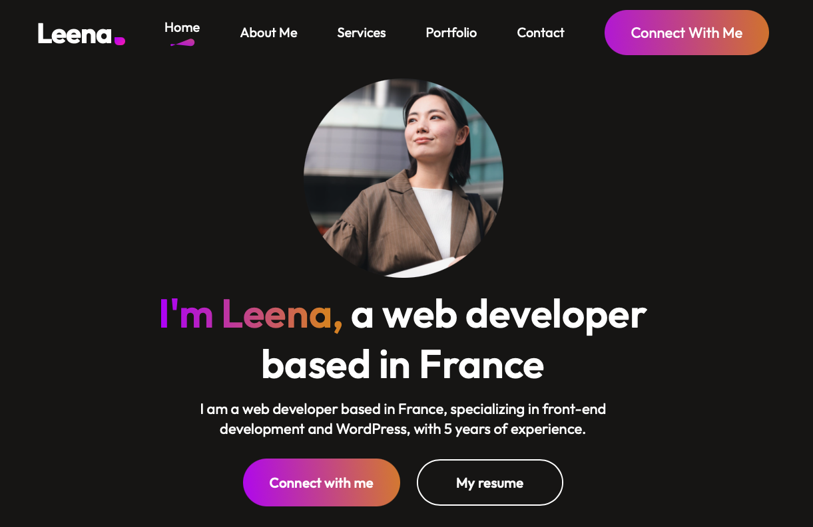

# 🌐 Portfolio Leena

A modern and responsive personal portfolio built with **React** and **Vite** to showcase my frontend development skills, services, and selected projects.

🔗 **Live demo:** [portfolio-yelle.vercel.app](https://portfolio-yelle.vercel.app)



---

## 🚀 Technologies

- React 19
- JavaScript (ES6+)
- HTML5
- CSS3 (Flexbox, Grid, media queries)
- Vite
- Web3Forms (contact form)
- ESLint
- Git & GitHub
- Vercel (deployment)

---

## ✨ Features

- Fully responsive design (desktop, tablet, mobile)
- Smooth scrolling navigation with a mobile slide-in menu
- Hero section with a call to action
- About section with skills and key figures
- Services section
- Portfolio gallery
- Working contact form (messages are sent by email)
- Hover animations and a gradient-based dark UI

---

## 📁 Project Structure

```text
portfolio_yelle/
├── public/
├── src/
│   ├── assets/
│   ├── Components/
│   │   ├── About/
│   │   ├── Contact/
│   │   ├── Footer/
│   │   ├── Hero/
│   │   ├── MyWork/
│   │   ├── Navbar/
│   │   └── Services/
│   ├── App.jsx
│   ├── index.css
│   └── main.jsx
├── index.html
├── package.json
├── vite.config.js
└── README.md
```

---

## ⚙️ Installation

Clone the repository:

```bash
git clone https://github.com/Yelle-stack/portfolio_yelle.git
cd portfolio_yelle
```

Install the dependencies:

```bash
npm install
```

Start the development server:

```bash
npm run dev
```

Then open [http://localhost:5173](http://localhost:5173) in your browser.

### Available scripts

| Command           | Description                    |
| ----------------- | ------------------------------ |
| `npm run dev`     | Start the development server   |
| `npm run build`   | Create a production build      |
| `npm run preview` | Preview the production build   |
| `npm run lint`    | Check the code with ESLint     |

---

## 📬 Contact

**Leena**
📍 France
📧 creation.siteweb@yahoo.com
💻 GitHub: [Yelle-stack](https://github.com/Yelle-stack)

---

⭐ 
